 

`THILINA LAKSHAN` &nbsp; / &nbsp; `SRI LANKA`

**A SOFTWARE ENGINEERING STUDENT WITH AN UNFINISHED MAP.**

[GitHub](https://github.com/thilinaofficial) &nbsp; ◈ &nbsp; [Explore my universe](#)

---

### 01 / THE UNKNOWN

# WHY STOP AT ONE?

I am interested in the things I haven't discovered yet.

From software and artificial intelligence to game worlds and experimental ideas, I enjoy moving between different areas of technology.

**My curiosity doesn't follow a single roadmap.**

---

### 02 / FREQUENCIES

# THINGS THAT CATCH MY ATTENTION

 

---

### 03 / THE TOOLKIT

# MY CREATIVE INSTRUMENTS

**CODE**

**BUILD**

**CREATE & EXPERIMENT**

---

### 04 / THE ARCADE

# INSERT COIN. MAKE CONTRIBUTIONS.

`PLAYER: THILINA` &nbsp; / &nbsp; `LEVEL: NEVER ENDING`

---

### 05 / END TRANSMISSION

# STILL EXPLORING.

**No final destination. Just another idea waiting to be built.**

 

`CURIOSITY` → `EXPERIMENTATION` → `CREATION`

 

